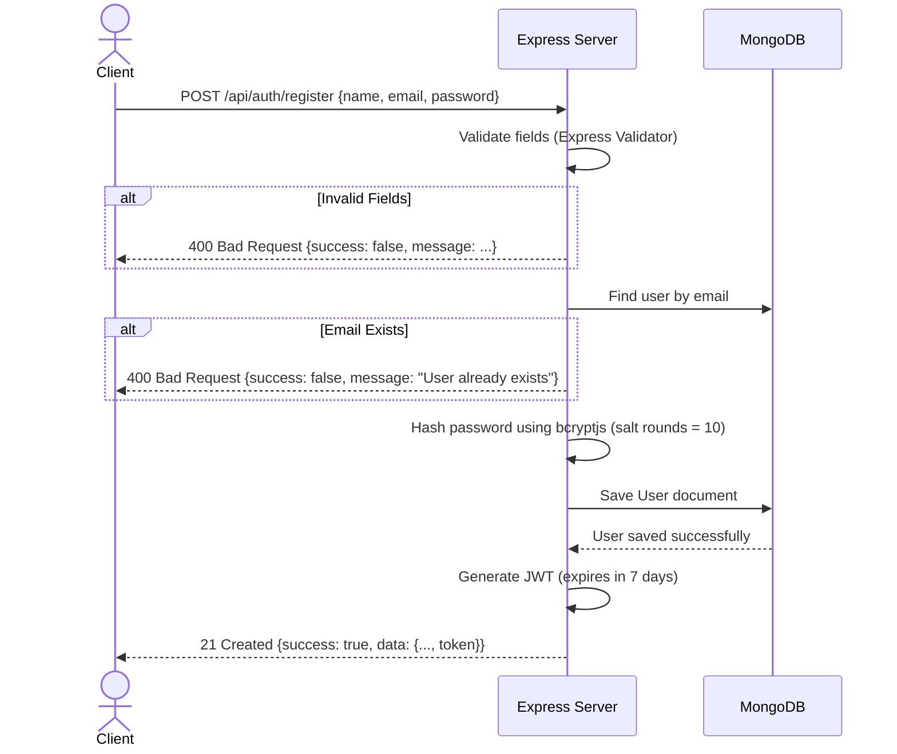
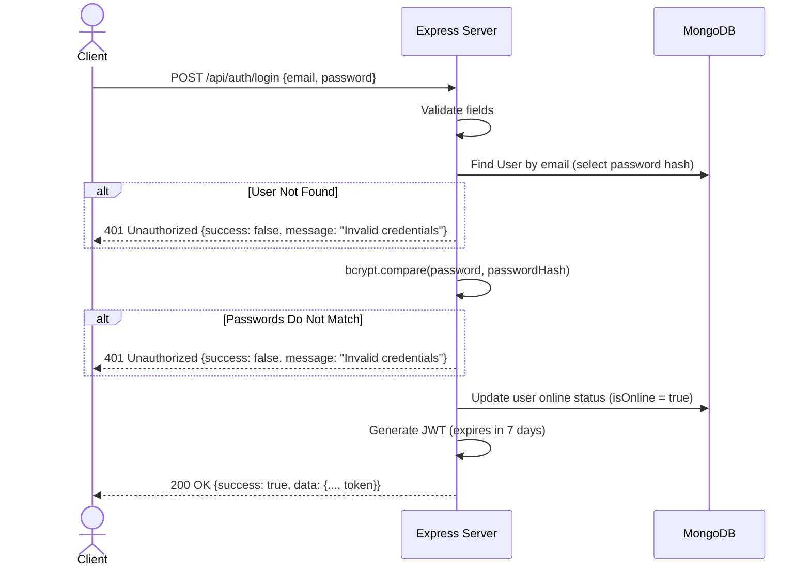
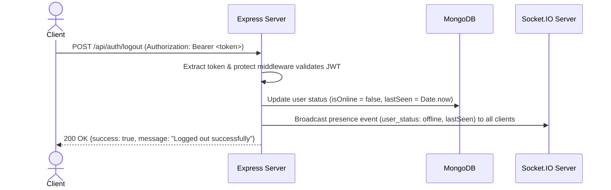

# Authentication Flow Design

This document details the authentication and security mechanics implemented in the Real-Time Chat Application.

---

## 1. Overview

The backend uses token-based stateless authentication using **JSON Web Tokens (JWT)**.
- **REST APIs**: Secured using an Authorization middleware that validates JWTs sent in the `Authorization: Bearer <token>` header.
- **Socket.IO connections**: Authenticated during the handshake phase using JWTs sent in the connection `auth` payload or headers.
- **Passwords**: Hashed securely using `bcryptjs` before database persistence. They are never stored in plain text and never exposed in API responses.

---

## 2. API Endpoints

### 2.1 Registration Flow (`POST /api/auth/register`)

Registers a new user account, performs input validation, hashes the password, and returns a signed JWT.



---

### 2.2 Login Flow (`POST /api/auth/login`)

Authenticates user credentials, generates a JWT, and marks the user's presence as online.



---

### 2.3 Logout Flow (`POST /api/auth/logout`)

Marks the user offline in the database, updates their last seen timestamp, and notifies other users via WebSockets.



---

## 3. Route Protection Middleware

The application defines a `protect` middleware inside [authMiddleware.js](file:///d:/logistics_app/real%20time%20chat%20application/src/middleware/authMiddleware.js) that intercepts incoming REST API requests to private routes:

1. **Extraction**: Checks if the `Authorization` header is present and starts with `Bearer `.
2. **Verification**: Verifies the signature of the token against `process.env.JWT_SECRET`.
3. **Retrieval**: Extends the `req` object by querying MongoDB for the user corresponding to the payload's `id` claim (and attaches it as `req.user`).
4. **Failure Handling**:
   - Missing header: returns `401 Unauthorized` with `"Not authorized, no token provided"`.
   - Expired token: returns `401 Unauthorized` with `"Not authorized, token expired"`.
   - Invalid signature/tampered token: returns `401 Unauthorized` with `"Not authorized, token invalid"`.

---

## 4. WebSocket Handshake Authentication

Socket.IO connections are protected by a custom `socketAuth` middleware.
- When connecting, the client must pass the JWT in the `auth` payload:
  ```javascript
  const socket = io("http://localhost:5000", {
    auth: {
      token: "your_jwt_token_here"
    }
  });
  ```
- The `socketAuth` handler interceptor extracts the token, verifies it, retrieves the user from MongoDB (excluding the password), and attaches the User object to the `socket` instance:
  ```javascript
  socket.user = user;
  ```
- If validation fails, the server rejects the connection. The client receives a `connect_error` event containing the validation issue (e.g. `Authentication error: Token expired`).
