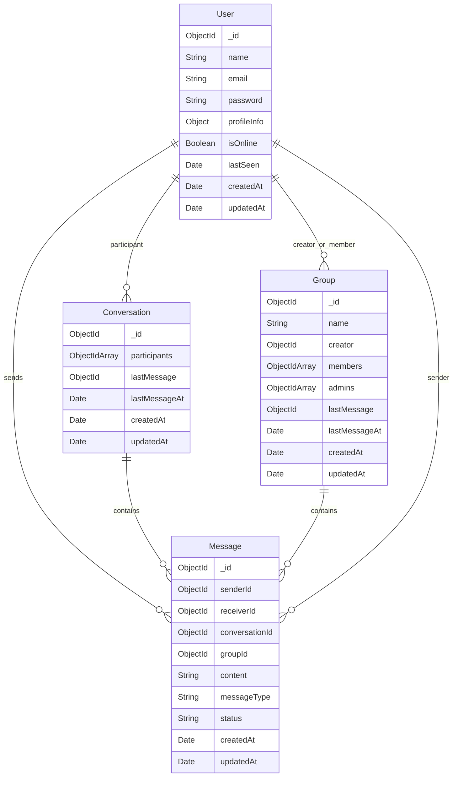

# Database Design: MongoDB Schemas

This document provides a detailed overview of the database design for the Real-Time Chat Application using MongoDB and Mongoose.

---

## 1. Data Models and Schema Structure

We use MongoDB with Mongoose schemas. Four core collections are used:
1. `users` (User Model)
2. `conversations` (Conversation Model)
3. `messages` (Message Model)
4. `groups` (Group Model)



---

## 2. Detailed Collection Specifications

### 2.1 User Collection (`users`)

Stores user credentials, profile information, and presence state.

| Field | Type | Description | Constraints / Validation |
| :--- | :--- | :--- | :--- |
| `_id` | `ObjectId` | Primary key | Auto-generated |
| `name` | `String` | User's full display name | Required, trimmed |
| `email` | `String` | User's unique email address | Required, unique, lowercase, regex-validated |
| `password` | `String` | Bcrypt-hashed password | Required, min length 6, excluded from queries by default |
| `profileInfo.avatar` | `String` | URL to user's profile image | Optional, default: empty string |
| `profileInfo.bio` | `String` | User's biography statement | Optional, max length 200, default: empty string |
| `isOnline` | `Boolean` | Real-time presence flag | Default: `false` |
| `lastSeen` | `Date` | Timestamp of last socket disconnection | Default: `Date.now` |
| `createdAt` | `Date` | Date of registration | Managed by Mongoose `timestamps` |
| `updatedAt` | `Date` | Date of last updates | Managed by Mongoose `timestamps` |

**Indexes:**
- Unique Index on `email`: `{ email: 1 }`
- Single Index on `isOnline`: `{ isOnline: 1 }`

---

### 2.2 Conversation Collection (`conversations`)

Represents one-to-one chats. This avoids duplicate queries and organizes message threads.

| Field | Type | Description | Constraints / Validation |
| :--- | :--- | :--- | :--- |
| `_id` | `ObjectId` | Primary key | Auto-generated |
| `participants` | `Array[ObjectId]` | Array referencing `User` | Required, exactly 2 participants |
| `lastMessage` | `ObjectId` | Reference to the latest `Message` | Optional |
| `lastMessageAt` | `Date` | Timestamp of the latest message | Optional (for sorting conversation threads) |
| `createdAt` | `Date` | Creation date | Managed by Mongoose `timestamps` |
| `updatedAt` | `Date` | Last updated date | Managed by Mongoose `timestamps` |

**Indexes:**
- Multi-key Index on `participants`: `{ participants: 1 }`

---

### 2.3 Message Collection (`messages`)

Stores the actual messages. Used for both direct (1-to-1) messages and group messages.

| Field | Type | Description | Constraints / Validation |
| :--- | :--- | :--- | :--- |
| `_id` | `ObjectId` | Primary key | Auto-generated |
| `senderId` | `ObjectId` | Reference to `User` | Required, indexed |
| `receiverId` | `ObjectId` | Reference to `User` | Optional (only for 1-to-1 messages) |
| `conversationId` | `ObjectId` | Reference to `Conversation` | Optional (only for 1-to-1 messages) |
| `groupId` | `ObjectId` | Reference to `Group` | Optional (only for group messages) |
| `content` | `String` | Message payload text | Required, trimmed, non-empty |
| `messageType` | `String` | Type of media | Enum: `['text', 'image', 'file']`, default: `'text'` |
| `status` | `String` | Receipts status (1-to-1) | Enum: `['sent', 'delivered', 'seen']`, default: `'sent'` |
| `createdAt` | `Date` | Sent timestamp | Managed by Mongoose `timestamps` |
| `updatedAt` | `Date` | Update timestamp | Managed by Mongoose `timestamps` |

**Indexes:**
- Compound Index for 1-to-1 paginated history: `{ conversationId: 1, createdAt: -1 }`
- Compound Index for group paginated history: `{ groupId: 1, createdAt: -1 }`
- Single Index on `senderId`: `{ senderId: 1 }`
- Single Index on `receiverId`: `{ receiverId: 1 }`
- Single Index on `status`: `{ status: 1 }`

---

### 2.4 Group Collection (`groups`)

Stores group metadata, membership lists, and role management.

| Field | Type | Description | Constraints / Validation |
| :--- | :--- | :--- | :--- |
| `_id` | `ObjectId` | Primary key | Auto-generated |
| `name` | `String` | Name of the group | Required, trimmed |
| `creator` | `ObjectId` | Reference to `User` (group owner) | Required |
| `members` | `Array[ObjectId]` | References to `User` in group | Required |
| `admins` | `Array[ObjectId]` | References to `User` with group admin rights | Required, defaults to creator |
| `lastMessage` | `ObjectId` | Reference to the latest `Message` | Optional |
| `lastMessageAt` | `Date` | Timestamp of the latest group message | Optional |
| `createdAt` | `Date` | Creation date | Managed by Mongoose `timestamps` |
| `updatedAt` | `Date` | Last updated date | Managed by Mongoose `timestamps` |

**Indexes:**
- Multi-key Index on `members`: `{ members: 1 }`

---

## 3. Query Optimization and Scalability

1. **Compound Indexes**: Querying message history is optimized using compound indexes:
   ```javascript
   MessageSchema.index({ conversationId: 1, createdAt: -1 });
   MessageSchema.index({ groupId: 1, createdAt: -1 });
   ```
   This ensures that retrieving messages for a specific conversation sorted by date (e.g. for scroll pagination) uses an index and avoids in-memory sorts in MongoDB.
2. **Lean Queries**: In read-heavy REST endpoints (e.g., retrieving lists of users or messages), Mongoose query performance is optimized by selecting only the required fields and excluding fields like password hashes.
3. **Reference Denormalization**: Storing `lastMessage` and `lastMessageAt` inside the `Conversation` and `Group` documents prevents expensive aggregation lookups when building the user's chat thread inbox.
