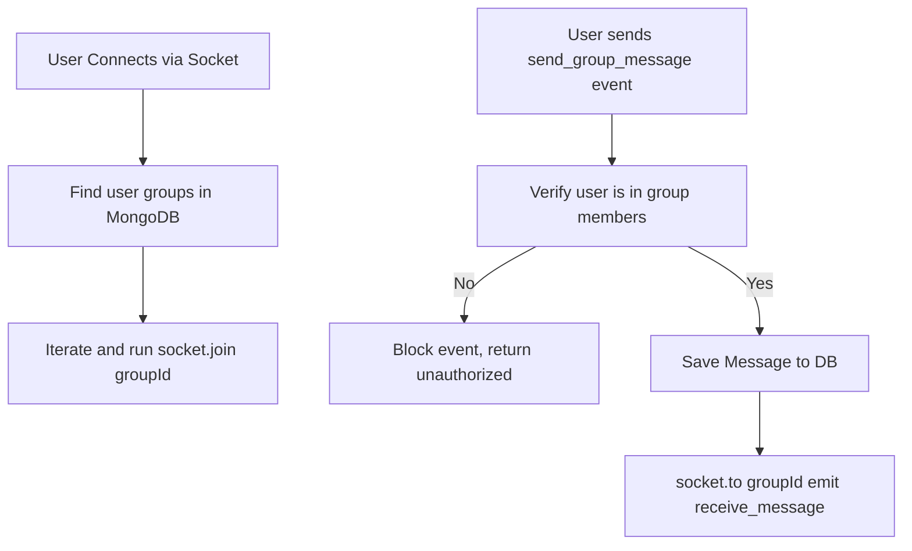

# Group Chat Architecture Design

This document details the architecture and implementation of the group chat functionality, focusing on Socket.IO rooms and MongoDB security controls.

---

## 1. Socket.IO Room Integration

Socket.IO natively supports "rooms", which allows broadcasting events to a specific subset of connected sockets.



### 1.1 Room Lifecycle Actions
1. **On Connection**:
   - The server queries the `Group` collection for all groups where `req.user._id` is in the `members` array.
   - For each group found, the server calls `socket.join(groupId.toString())`.
2. **On Group Creation**:
   - When an API client creates a group via `POST /api/groups`, the creator's active sockets are immediately added to the new Socket.IO room.
3. **On Adding Members**:
   - When an admin adds users to a group (`POST /api/groups/:id/members`), the server locates the active socket connections of those users and calls `socket.join(groupId.toString())` on them dynamically.
4. **On Member Removal / Leaving**:
   - When a member is removed or leaves (`DELETE /api/groups/:id/members/:userId`), the server locates their active sockets and calls `socket.leave(groupId.toString())` on them.

---

## 2. Database Schema & Indexing

The `groups` collection stores the metadata:
- `name`: Group display name.
- `creator`: The User ID who created the group.
- `members`: Array of User IDs.
- `admins`: Array of User IDs who can add/remove members.
- `lastMessage`: Reference to the latest Message.
- `lastMessageAt`: Date.

### Indexing
An index on `members` `{ members: 1 }` is applied. This optimizes:
- Finding all groups a user belongs to on login/connect.
- Checking membership status during API actions.

---

## 3. Authorization and Access Control

### 3.1 REST API Security
- **Membership Check**: Before displaying group details (`GET /api/groups/:id`) or messages (`GET /api/groups/:id/messages`), the server checks:
  ```javascript
  if (!group.members.includes(req.user._id)) {
    return res.status(403).json({ message: "Unauthorized access" });
  }
  ```
- **Admin Check**: Before adding members (`POST /api/groups/:id/members`), the server verifies the user's role:
  ```javascript
  if (!group.admins.includes(req.user._id)) {
    return res.status(403).json({ message: "Admin privileges required" });
  }
  ```

### 3.2 WebSocket Security
- In the `send_group_message` event listener, the server queries the database (or cache) to verify the sender is part of `group.members` before broadcast. If validation fails, the event is ignored and the socket is sent an unauthorized error.
- Message status receipts (`delivered`, `seen`) are not broadcasted to the entire group by default, keeping group bandwidth light and scalable.
