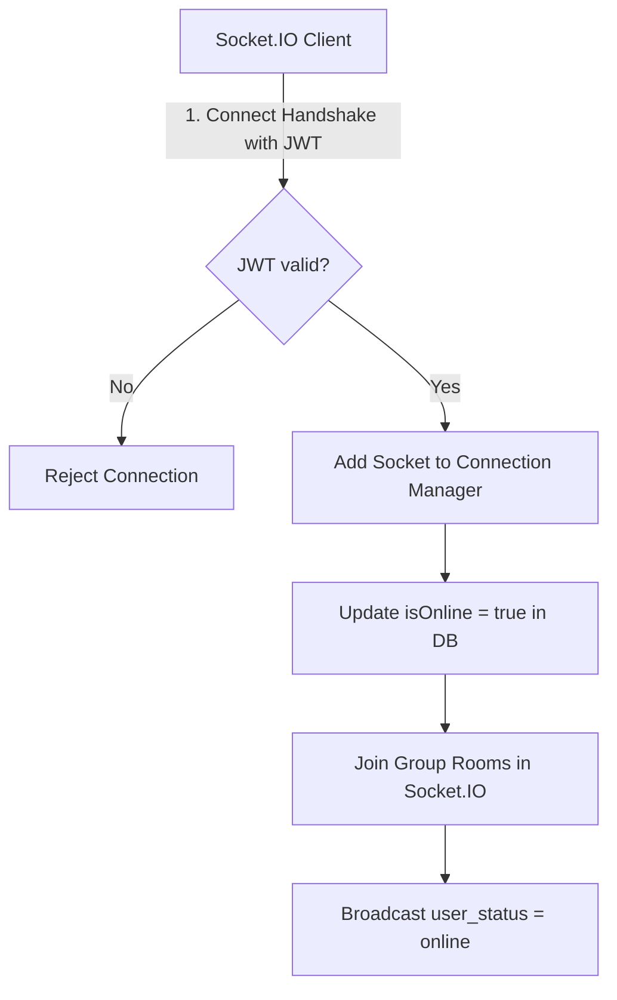

# WebSocket Architecture Design

This document details the real-time communication architecture of the Real-Time Chat Application built with Socket.IO.

---

## 1. Connection & Session Management

To handle real-time events, Socket.IO is integrated with the Node.js HTTP server.



### 1.1 Multi-Device Support
A user can connect from multiple devices or browser tabs simultaneously. To support this:
- The backend implements a [ConnectionManager](file:///d:/logistics_app/real%20time%20chat%20application/src/socket/connectionManager.js) which maps `userId -> Set(socketIds)`.
- When a new socket connects, it is added to the user's set.
- A user is marked **online** (and an status event is broadcasted) only on the *first* socket connection.
- When a socket disconnects, it is removed from the user's set.
- A user is marked **offline** (and a status event is broadcasted) only when the *last* active socket connection is closed.

---

## 2. Event API Specifications

### 2.1 Connection Event Handlers (Inbound)

#### `send_message`
- **Sender**: Active user socket
- **Payload**:
  ```json
  {
    "receiverId": "60d0fe4f5311236168a109ca",
    "conversationId": "60d0fe735311236168a109cb", 
    "content": "Hello there!",
    "messageType": "text"
  }
  ```
- **Server Behavior**:
  1. Validates sender and message content.
  2. Resolves or creates a `Conversation`.
  3. Saves the message to MongoDB with status `delivered` (if receiver is online) or `sent` (if offline).
  4. Returns the saved message in the socket acknowledgment callback.
  5. Emits `receive_message` to all of the receiver's online sockets.
  6. Emits `receive_message` to the sender's other concurrent sockets (for tab syncing).

#### `send_group_message`
- **Sender**: Group member socket
- **Payload**:
  ```json
  {
    "groupId": "60d0fe895311236168a109cc",
    "content": "Hi team!",
    "messageType": "text"
  }
  ```
- **Server Behavior**:
  1. Validates that the sender is a member of the group.
  2. Saves the message to MongoDB.
  3. Returns the message in the acknowledgment callback.
  4. Broadcasts `receive_message` to the Socket.IO room named `<groupId>`.

#### `typing` / `stop_typing`
- **Sender**: Typing user socket
- **Payload**:
  ```json
  {
    "conversationId": "60d0fe735311236168a109cb",
    "receiverId": "60d0fe4f5311236168a109ca"
  }
  ```
  *(or `{ "groupId": "60d0fe895311236168a109cc" }`)*
- **Server Behavior**:
  - Forwards `user_typing` / `stop_typing` to the receiver's personal room or the group room (excluding the sender).

#### `mark_seen`
- **Sender**: User viewing a chat
- **Payload**:
  ```json
  {
    "conversationId": "60d0fe735311236168a109cb"
  }
  ```
- **Server Behavior**:
  1. Sets `status = 'seen'` for all messages in the conversation where `senderId != currentUserId` and `status != 'seen'`.
  2. Emits `messages_seen` to the original sender to update their UI with read receipts.

---

### 2.2 Server Emitted Events (Outbound)

#### `receive_message`
- **Receiver**: Recipient user or group members
- **Payload**: Fully populated message object:
  ```json
  {
    "_id": "60d0feaa5311236168a109cd",
    "senderId": { "_id": "60d0fe4f...", "name": "User A" },
    "content": "Hello there!",
    "conversationId": "60d0fe73...",
    "status": "delivered",
    "createdAt": "2026-08-12T12:00:00.000Z"
  }
  ```

#### `message_status`
- **Receiver**: Sender of a message
- **Payload**:
  ```json
  {
    "messageId": "60d0feaa5311236168a109cd",
    "conversationId": "60d0fe73...",
    "status": "delivered"
  }
  ```

#### `messages_seen`
- **Receiver**: Original sender of read messages
- **Payload**:
  ```json
  {
    "conversationId": "60d0fe73...",
    "seenBy": "60d0fe4f...",
    "seenAt": "2026-08-12T12:05:00.000Z"
  }
  ```

#### `user_status`
- **Receiver**: All connected users
- **Payload**:
  ```json
  {
    "userId": "60d0fe4f...",
    "isOnline": false,
    "lastSeen": "2026-08-12T12:10:00.000Z"
  }
  ```

---

## 3. Horizontal Scalability (Future Enhancement)

Currently, the connection manager is stored **in-memory**, which means it only tracks connections on a single server instance. To scale Socket.IO across multiple servers (e.g. behind a load balancer):

1. **Redis Adapter (`@socket.io/redis-adapter`)**:
   - Replace the default in-memory adapter with the Socket.IO Redis Adapter.
   - When a message is sent to a user or room, Redis broadcasts the event to all server nodes, ensuring users connected to different instances receive their messages in real time.
2. **Shared Presence Tracking**:
   - Instead of using a local `Map` in `connectionManager.js`, store user connection counts in a Redis hash.
   - Query Redis to check if a user is online across any server instance.
